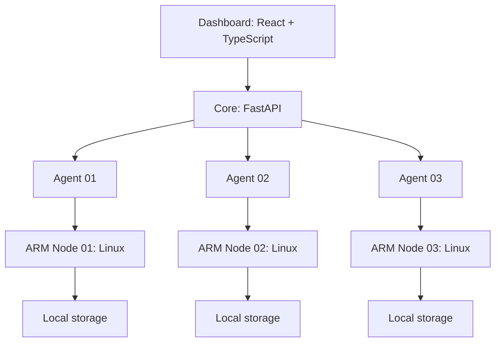

# PixelMachine

**Open-source modular ARM home server.**

*Old hardware. New purpose.*

> Статус: концепция / pre-alpha. Рабочий аппаратный прототип пока не собран. Все характеристики и возможности ниже являются целями проекта, а не подтверждёнными результатами испытаний.

## О проекте

PixelMachine — проект компактного домашнего сервера на базе бывших в употреблении ARM-смартфонов. Цель — дать старому оборудованию вторую жизнь и создать доступную, модульную, самостоятельно обслуживаемую альтернативу аренде VPS для некритичных домашних задач.

Первый кандидат — Google Pixel 3a (Snapdragon 670, 4 ГБ RAM, 64 ГБ eMMC). Ориентир стоимости телефона — 2 900 ₽ по найденному объявлению; стоимость полной системы пока неизвестна.

## Принципы

- Открытый исходный код программного обеспечения и моделей корпуса.
- Независимые вычислительные узлы и постепенное масштабирование от одного до трёх устройств.
- Локальное управление, контроль собственных данных и отсутствие обязательной облачной подписки.
- Ремонтопригодность, повторное использование оборудования и доступность компонентов.
- Безопасность и стабильность важнее компактности и экономии.

## Аппаратная концепция

| Компонент | План |
| --- | --- |
| Вычислительные узлы | 1–3 ARM64-смартфона, первоначально Pixel 3a |
| Операционная система | postmarketOS, без графического рабочего стола |
| Накопители | Встроенная eMMC и до трёх внешних SSD при подтверждённой USB-совместимости |
| Корпус | Компактный куб в эстетике Steam Machine, сменная декоративная панель, выдвижные кассеты |
| Охлаждение | Концепция параллельного воздушного потока через независимые отсеки |
| Сеть | Wi-Fi; Ethernet при наличии совместимого адаптера |
| Сервисный отсек | Нижняя зона для накопителей и USB-периферии |

Размеры, материалы, тепловые характеристики и совместимость пока не утверждены. Для первого прототипа предполагается использование штатного исправного устройства и питания. Любые аппаратные изменения питания или закрытая компоновка требуют профессиональной проверки безопасности; схемы переделки питания не входят в текущий проект.

Замена узла предполагает штатную остановку сервисов и самого устройства перед отсоединением. Это не электрический hot swap. Остальные узлы могут продолжать работу при отсутствии критических зависимостей.

## Архитектура ПО



- **Core:** реестр узлов, API, агрегирование телеметрии и управление сервисами.
- **Agent:** сбор CPU/RAM, температур (если доступны), дискового пространства, сетевой статистики и состояния сервисов.
- **Dashboard:** тёмный минималистичный интерфейс с навигацией в эстетике Liquid Glass.
- **OS:** конфигурации postmarketOS, профили совместимых устройств и воспроизводимое развёртывание.
- **Hardware:** исходные CAD-модели и документация корпуса после проверки прототипа.

Узлы имеют собственную память и накопители. Суммарные 12 ГБ RAM при трёх Pixel не являются единым адресным пространством. Автоматическое распределение нагрузки и перенос сервисов — будущие функции, не возможности MVP.

## Панель управления

| Раздел | Планируемые функции |
| --- | --- |
| Обзор | Статус кластера, нагрузка, uptime |
| Узлы | Метрики, сервисы, журналы, состояние отдельных устройств |
| Охлаждение | Схема воздушных потоков, доступные температуры и статус охлаждения |
| Диски | Ёмкость, свободное место, доступные показатели здоровья, бэкапы |
| Сеть | Адреса узлов, трафик, доступность сервисов |
| Настройки | Пользователи, конфигурации, управление доступом |

Управление реальным охлаждением рассматривается только после проверки совместимого контроллера и независимой аппаратной защиты. Первый интерфейс работает с симулированными данными или телеметрией в режиме чтения.

## Варианты использования

- Личные сайты, демонстрационные стенды и небольшие API.
- Telegram- и Twitch-боты.
- Nginx/Caddy, Python, Node.js.
- SQLite, PostgreSQL, Redis при достаточных ресурсах.
- Изучение Linux, DevOps, мониторинга и распределённых систем.

## Безопасность и надёжность

Панель управления и базы данных не должны быть общедоступны из интернета. Планируются аутентификация узлов, разграничение прав, HTTPS, защищённое хранение секретов, ограничение журналов, резервные копии вне кластера и проверка восстановления. Поддержка USB Host, температурных датчиков, сетевых адаптеров и контейнеризации зависит от ядра и устройства и должна быть проверена отдельно.

## Предлагаемая структура репозитория

```text
PixelMachine/
├── README.md
├── core/          # API и управление узлами
├── agent/         # Телеметрия Linux-узлов
├── dashboard/     # React + TypeScript
├── os/            # Конфигурации и профили устройств
├── hardware/      # CAD и документация корпуса
├── docs/          # Архитектура, испытания, совместимость
└── tests/         # Автоматические тесты
```

Каталоги пока являются планом, а не реализованными компонентами.

## Roadmap

- [ ] v0.1 — проверить один Pixel 3a: загрузка Linux, SSH, сеть, стабильность и безопасное штатное питание.
- [ ] v0.2 — создать агент телеметрии, Core API и симулятор узлов.
- [ ] v0.3 — разработать Dashboard с вкладками и интерактивной схемой.
- [ ] v0.4 — проверить SSD, USB, резервные копии и восстановление после отключения.
- [ ] v0.5 — разработать CAD-концепцию корпуса и провести проверку теплового режима и безопасности со специалистом.
- [ ] v0.6 — проверить работу нескольких независимых узлов, обнаружение отказов и обслуживание.
- [ ] v1.0 — выпустить документацию и воспроизводимый проверенный прототип.

## Критерии первого рабочего прототипа

Стабильная работа одного узла под типовой нагрузкой в течение недели, проверенное восстановление сервисов и данных, отсутствие непредусмотренных перезагрузок, подтверждённая безопасность питания и теплового режима. Потребление измеряется от розетки; экономическая оценка учитывает полную стоимость оборудования, электричества и подключения.

## Лицензирование и вклад сообщества

Проект распространяется под лицензией [MIT](LICENSE). Сторонние компоненты сохраняют собственные лицензии. Отдельное лицензирование будущих аппаратных моделей может быть рассмотрено позднее. Название PixelMachine не означает официальной связи с Google или Valve.

Предложения по архитектуре, совместимости устройств, интерфейсу и тестированию приветствуются. Пока проект находится на стадии планирования.

---

*Your hardware. Your data. Your infrastructure.*
